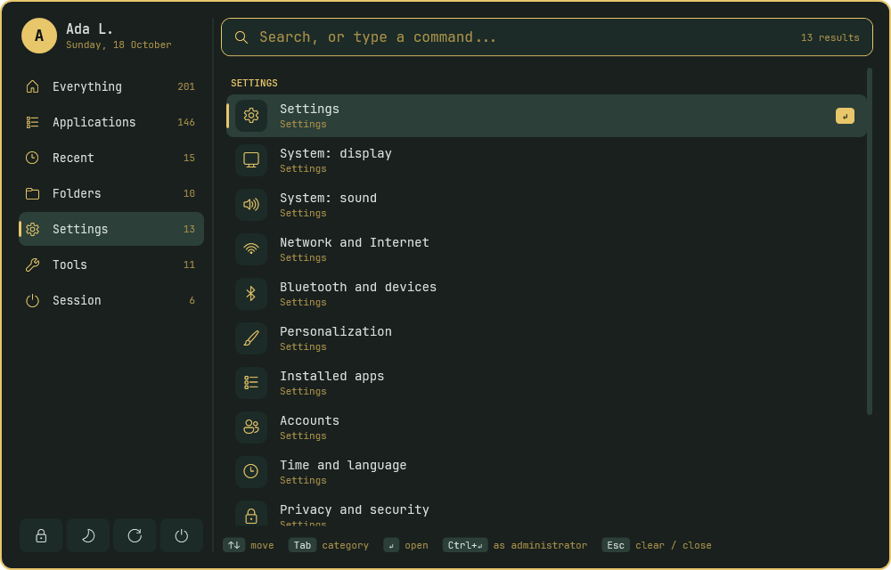
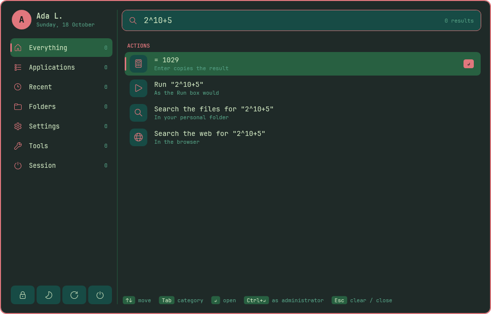
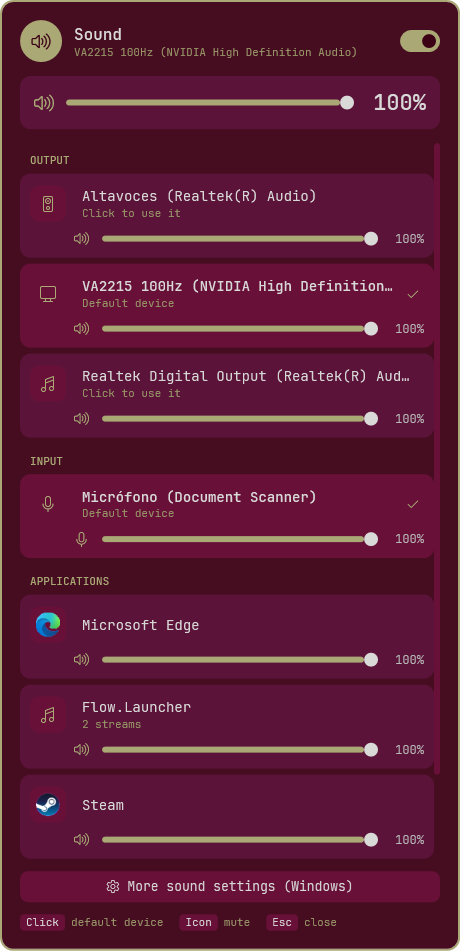
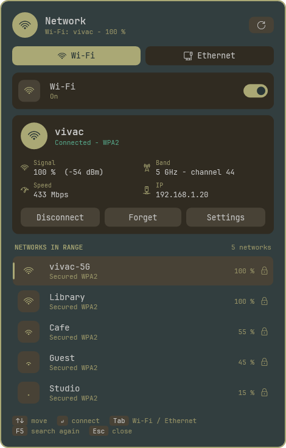
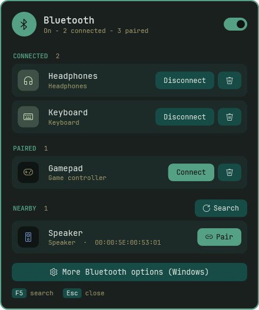
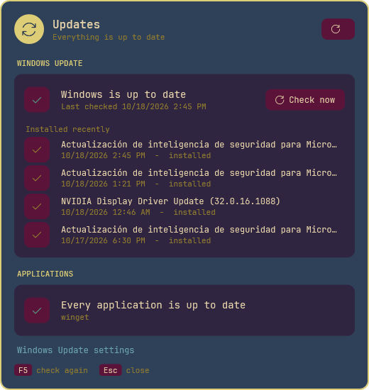
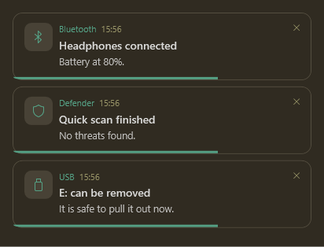
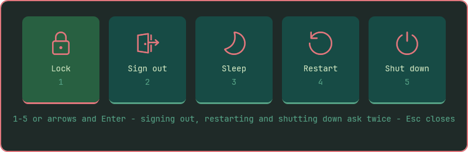
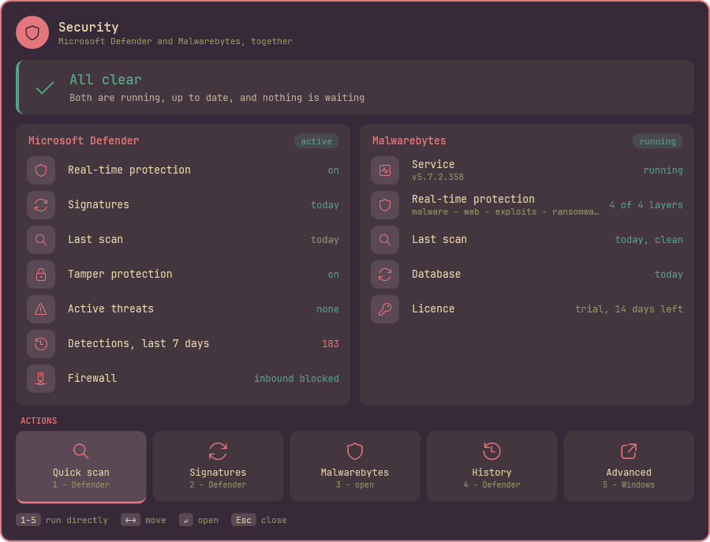
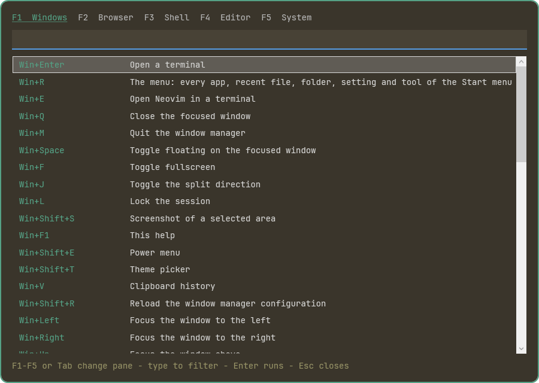

<div align="center">


<p>
<em>A <strong>vivac</strong> is the camp you pitch from what you carry and strike at dawn.<br>
This is the <a href="https://github.com/gitsual/vivac">vivac</a> workstation, pitched on Windows 11.</em><br>
<strong>What you carry is the same one file — twenty-odd lines of colour. The wallpaper, the bar, the borders and every window vivac draws are rendered from it, none of them painted by hand. There are eight such files.</strong>
</p>

<p>
  
  
  
  
  
</p>

<a href="#-get-it"><strong>Get it</strong></a> ·
<a href="#-the-surfaces-it-draws-itself"><strong>The surfaces</strong></a> ·
<a href="#-the-eight"><strong>The eight</strong></a> ·
<a href="#-how-colour-works"><strong>How colour works</strong></a> ·
<a href="#-what-it-asks-of-windows"><strong>What it asks of Windows</strong></a> ·
<a href="#-verification"><strong>Verification</strong></a>

</div>

---

<a href="#-the-eight"></a>

<div align="center">

**os** Windows 11 · **wm** [GlazeWM](https://github.com/glzr-io/glazewm) · **bar** [Zebar](https://github.com/glzr-io/zebar) · **term** Windows Terminal<br>
**editor** Neovim / NvChad · **menu** vivac's own, on `Win+R` · **notify** vivac's own cards · **lock** vivac's own, hyprlock-style<br>
**panels** sound · Bluetooth · Wi-Fi & Ethernet · security · updates — all vivac's, in WPF · **font** JetBrains Mono Nerd Font<br>
**colour** `data/theme.conf` → `templates/` → `dotfiles/` · **scripts** Windows PowerShell 5.1, nothing to install first

<br>

<sub>Two kinds of image on this page, and no third. The wallpapers are <b>rendered</b> —
<code>scripts/make-wallpaper.ps1 -All</code> turns <code>data/themes/*.conf</code> into SVG and then into pixels.
Every window below is <b>drawn by the real code</b> — <code>scripts/make-readme-assets.ps1</code> opens each
surface through <code>tests/tools/shot-surface.ps1</code>, off screen and in a scratch profile, and saves what
WPF rendered. No mockups, nothing hand-painted. Where a window would show something of the machine that took
the picture — an account name, the networks in range, an address, the devices nearby — it carries sample
values instead, replaced at capture time; the script says which and how.</sub>

</div>

---

## 📥 Get it

<table>
<tr>
<th width="50%">Install it</th>
<th width="50%">Look before you leap</th>
</tr>
<tr>
<td valign="top">

On Windows 11, from an ordinary PowerShell. No elevation: what needs an
administrator is a separate, opt-in step with a dry run of its own.

```powershell
git clone https://github.com/gitsual/vivac-windows.git C:\vivac
cd C:\vivac
powershell -ExecutionPolicy Bypass -File scripts\bootstrap.ps1 -DryRun
powershell -ExecutionPolicy Bypass -File scripts\bootstrap.ps1 -Editor
```

`bootstrap.ps1` installs the base packages with winget (plus the optional
sets you ask for: `-Editor`, `-Desktop`, `-Security`; `-ListSelectors` says
which apply here), detects the hardware, deploys every configuration, starts
GlazeWM and opens the first-run wizard.

</td>
<td valign="top">

Nothing is deleted. A file in the way goes to
`%LOCALAPPDATA%\vivac\backups\<timestamp>\` first, and the way back is one
command:

```powershell
scripts\deploy.ps1 -DryRun       # what a deploy would write, writing nothing
scripts\check.ps1                # every gate
scripts\uninstall.ps1 -DryRun    # what it would put back
scripts\uninstall.ps1            # put it back
```

Uninstall restores what was there before — the wallpaper, the accent colour,
the taskbar, every banner switch and system setting vivac touched.

</td>
</tr>
</table>

---

## 🎨 Why this exists

The [source](https://github.com/gitsual/vivac) is an Arch Linux workstation whose whole look is one
palette file, rendered into everything else. This is that workstation pitched on Windows 11, with the
doctrine carried over intact and the floor underneath replaced: Hyprland becomes GlazeWM, Waybar a Zebar
widget, rofi a menu vivac draws itself, dunst vivac's own notification cards, hyprlock vivac's own lock,
pacman winget, Stow a deploy with a manifest and backups. [docs/mapping.md](docs/mapping.md) has the whole
table, including what does **not** carry over and why.

**The palette is still the only place a colour is written.** A committed render that disagrees with its
template fails the build; a colour that exists in no corpus fails the build; a wallpaper that claims an
ornament it has not earned fails the build.

### ✨ What you get

- **🎨 Eight palettes, one switch.** `Win+Shift+T` or `scripts\apply-theme.ps1 -Theme NAME` — wallpaper, accent colour, window borders, bar, lock screen, every vivac window and every terminal already open.
- **🧭 A menu instead of the Start menu.** `Win+R`: every application, recent file, folder, settings page and Win+X tool, with real icons, categories, what you use most first, a calculator and a run box. Explorer's own Win+R is switched off (`apply-system.ps1 -WinKeys`) so nothing opens behind it.
- **🔔 Notifications in the palette.** Other programs' notifications arrive as vivac's cards at the top right, under the bar; Windows' banners at the bottom right are switched off program by program (`-Toasts`), and every switch is put back by uninstall. Windows Security keeps its own, on purpose.
- **🎛️ The quick settings, redrawn.** Sound with a mixer, Bluetooth with pairing, Wi-Fi and Ethernet with the key asked in the panel, Defender and Malwarebytes in one security view, Windows Update and winget in one updates view — each a click on the bar.
- **🔒 A lock that wears the theme.** `Win+L`; an empty Enter asks Windows Hello, Ctrl+Alt+Del hands over to Windows' own lock.
- **📋 A clipboard history that stays in memory.** `Win+V`, never written to disk.
- **🖥️ A bar that only shows what the machine has.** The Wi-Fi gauge needs an adapter, the battery a battery, the GPU temperature an NVIDIA card — rendered per machine from detected hardware facts.
- **🛡️ UAC left whole.** Nothing elevated runs a file you can change without elevation; see [What it asks of Windows](#-what-it-asks-of-windows).
- **✅ 14 gate files before anything ships.** Parsing, encoding, palettes, renders, keys, strings, hardware detection, the surfaces in every theme and a two-pass deploy regression.

### ⚡ 60-second tour

```powershell
git clone https://github.com/gitsual/vivac-windows.git C:\vivac; cd C:\vivac
powershell -ExecutionPolicy Bypass -File scripts\bootstrap.ps1 -DryRun   # what it would install and write
powershell -ExecutionPolicy Bypass -File scripts\check.ps1               # the whole gate suite
```

Neither needs an administrator, and neither writes outside the checkout.

---

## 🪟 The surfaces it draws itself

Every window vivac shows is WPF, built from the same kit — icon tiles, rounded rows, cards, switches and
the keys at the foot as key caps — and coloured from the palette at the moment it opens. Each picture
below is that window in a different palette.

<table>
  <tr>
    <td width="50%" align="center"><a href="assets/screenshots/surface-menu.png"></a></td>
    <td width="50%" align="center"><a href="assets/screenshots/surface-menu-calc.png"></a></td>
  </tr>
  <tr>
    <td align="center"><b>The menu</b> · <sub>Cosmos</sub><br><sub><code>Win+R</code> · every app of the Start menu with its own icon, recent files, folders, settings pages, the Win+X tools and the session, in categories; <code>Tab</code> walks them</sub></td>
    <td align="center"><b>The menu, typing</b> · <sub>Persephone</sub><br><sub>a sum is answered on the spot (<code>Enter</code> copies it); anything typed can be run, searched for in your files or on the web</sub></td>
  </tr>
</table>

<table>
  <tr>
    <td width="33%" align="center"><a href="assets/screenshots/surface-sound.png"></a></td>
    <td width="33%" align="center"><a href="assets/screenshots/surface-network.png"></a></td>
    <td width="33%" align="center"><a href="assets/screenshots/surface-bluetooth.png"></a></td>
  </tr>
  <tr>
    <td align="center"><b>Sound</b> · <sub>Carmen</sub><br><sub>the volume pill on the bar · outputs and inputs (click one to make it the default), and every program playing, with its own icon and slider</sub></td>
    <td align="center"><b>Wi-Fi & Ethernet</b> · <sub>Metropolis</sub><br><sub>the network pills · the networks in range, strongest first; a saved one joins at a click, a new one asks for its key in the panel and never writes it to a file</sub></td>
    <td align="center"><b>Bluetooth</b> · <sub>Northern Lights</sub><br><sub>the Bluetooth pill · connected, paired and nearby, each with a glyph for what it is, its battery when it reports one, and pairing through Windows' own prompt</sub></td>
  </tr>
  <tr>
    <td align="center"><a href="assets/screenshots/surface-updates.png"></a></td>
    <td align="center"><a href="assets/screenshots/surface-notifications.png"></a></td>
    <td align="center"><a href="assets/screenshots/surface-power.png"></a></td>
  </tr>
  <tr>
    <td align="center"><b>Updates</b> · <sub>Gatsby</sub><br><sub>the icon at the far right of the bar · Windows Update and winget in one place; programs update without a prompt, installing something new still asks</sub></td>
    <td align="center"><b>Notifications</b> · <sub>The Hermit</sub><br><sub>any program's, read from Windows' own record of them and drawn as these cards; a click opens the program, the pointer holds them</sub></td>
    <td align="center"><b>Power</b> · <sub>Persephone</sub><br><sub><code>Win+Shift+E</code> · lock, sign out, sleep, restart, shut down; the last three ask twice</sub></td>
  </tr>
</table>

<table>
  <tr>
    <td width="60%" align="center"><a href="assets/screenshots/surface-security.png"></a></td>
    <td width="40%" align="center"><a href="assets/screenshots/surface-help.png"></a></td>
  </tr>
  <tr>
    <td align="center"><b>Security</b> · <sub>Bad Romance</sub><br><sub>the shield on the bar · Microsoft Defender and Malwarebytes side by side under one verdict, read without elevation; a quick scan, the signatures and the history one key away</sub></td>
    <td align="center"><b>Help</b> · <sub>The Hermit</sub><br><sub><code>Win+F1</code> · every key, from <code>data/help-registry.tsv</code>; a live binding the registry does not know shows up as <code>UNREGISTERED</code></sub></td>
  </tr>
</table>

Nothing here is a committed English render: the labels come from `i18n/` (English and Spanish), the
actions never do. A translation can change what a button says and cannot change what it does.

---

## 🖼️ The eight

The catalogue is the source's, palette for palette. Every wallpaper below is rendered from its theme file
by `scripts\make-wallpaper.ps1`; an ornament is drawn only where the theme has earned one.

<table>
  <tr>
    <td width="50%" align="center"><a href="assets/wallpapers/bad-romance.png"></a><br><b>Bad Romance</b> · <sub>Nocturne · <code>data/theme.conf</code> · the default</sub></td>
    <td width="50%" align="center"><a href="assets/wallpapers/metropolis.png"></a><br><b>Metropolis</b> · <sub>Resistance</sub></td>
  </tr>
  <tr>
    <td align="center"><a href="assets/wallpapers/carmen.png"></a><br><b>Carmen</b> · <sub>Appetite</sub></td>
    <td align="center"><a href="assets/wallpapers/northern-lights.png"></a><br><b>Northern Lights</b> · <sub>Quartz</sub></td>
  </tr>
  <tr>
    <td align="center"><a href="assets/wallpapers/gatsby.png"></a><br><b>Gatsby</b> · <sub>Nostalgia</sub></td>
    <td align="center"><a href="assets/wallpapers/the-hermit.png"></a><br><b>The Hermit</b> · <sub>Endurance</sub></td>
  </tr>
  <tr>
    <td align="center"><a href="assets/wallpapers/cosmos.png"></a><br><b>Cosmos</b> · <sub>Technique · constellation</sub></td>
    <td align="center"><a href="assets/wallpapers/persephone.png"></a><br><b>Persephone</b> · <sub>Romance · vine</sub></td>
  </tr>
</table>

```powershell
scripts\apply-theme.ps1 -List
scripts\apply-theme.ps1 -Theme persephone -DryRun
scripts\make-wallpaper.ps1 -All    # every wallpaper, SVG + 3840x2160 PNG, into dist\wallpapers
```

---

## 🧬 How colour works

Exactly as in the source. `data/theme.conf` holds the palette; everything that carries a colour is a
template under `templates/` and is rendered into `dotfiles/`; a gate fails when a committed render and its
template disagree. Every colour must exist in `data/palette-corpus.tsv` — a colour with no cause is slop —
and a wallpaper carries an ornament only when the theme has earned one.

Templates use the source's syntax: `@COLOR_BG@`, `@COLOR_BG:lower@`, `@COLOR_BG:rgb@` and the derived
shades `:dark`, `:darker`, `:dim`. The per-machine templates under `render/` also see the settings
(`@SET_MOD@`), the hardware facts, and guard lines such as `@?has_battery=yes@`.

What Windows draws is coloured too, where Windows lets it be: the accent colour and dark mode, the lock and
sign-in screen wallpaper, and — with `apply-system.ps1 -Boot` — GRUB's menu and the boot logo, following
every theme switch. vivac's own windows read the palette the moment they open, so a switch reaches the
next one without a restart.

---

## 🛡️ What it asks of Windows

**Nothing, to start.** Bootstrap, deploy, theme switches and uninstall run as you. Everything that needs an
administrator is an opt-in profile of `scripts\apply-system.ps1`, each with a `-DryRun`, each saved and
put back by uninstall:

| Profile | What it does |
|---|---|
| `-Session` | GlazeWM, and with it the bar, at sign-in |
| `-Idle` | lock after 5 minutes, screen off after 10, sleep after 30 |
| `-Taskbar` | no Windows taskbar; the bar takes its place, with pills for what the tray held |
| `-DesktopIcons` | no icons on the desktop, and installers' shortcuts moved into the Start menu |
| `-WinKeys` | Explorer gives up Win+R, so the Run box never opens over vivac's menu |
| `-Toasts` | other programs' notifications as vivac's cards; Windows' banners off (Windows Security keeps its own) |
| `-LockScreen` | the theme's wallpaper on the lock and sign-in screens |
| `-Firewall` · `-Defender` · `-SecurityQuiet` | every firewall profile on; PUA blocking and cloud protection; Windows Security without its tray icon (threat alerts stay Windows' own) |
| `-Boot` | GRUB's menu and the boot logo in the theme |

**UAC stays whole.** A few things run elevated without a prompt — updating installed programs through
winget, the key guard that keeps the Windows key vivac's in front of an administrator's window — and a
task like that must never run a file you can change without elevation, or any program running as you
could edit it and become administrator. So `scripts\protect-tasks.ps1` copies what such a task runs into
`C:\Program Files\vivac`, which only administrators can write, gives its logs and its queue folders of
their own under `C:\ProgramData\vivac`, and then audits every elevated task on the machine, failing if one
still runs a user-writable file. Installing something new is never on that path: it goes through winget
and the installer's own UAC prompt.

---

## ⌨️ Day to day

`Win` is the modifier, as `Super` is in the source (`mod=alt` in `%APPDATA%\vivac\settings`, or the
wizard, switches to Alt). [docs/keys.md](docs/keys.md) is every key, generated from the same registry as
the help pane.

| | |
|---|---|
| `scripts\deploy.ps1 [-DryRun] [-Package glazewm,zebar,...]` | Render and place the configuration again |
| `scripts\apply-theme.ps1 -Theme NAME` | Switch palette, live |
| `scripts\apply-system.ps1 -DryRun -Session -Idle -Toasts` | The opt-in profiles above |
| `scripts\protect-tasks.ps1 -Check` | Whether the protected copies are stale after an update (run it elevated without `-Check` to refresh them) |
| `scripts\security-audit.ps1` | Read-only audit: antivirus, exclusions, firewall, autoruns, tasks, services, updates, UAC |
| `scripts\task.ps1 -Name NAME -Register` | A JSON-described task in the Task Scheduler ([example](profiles/automation/example.json)) |
| `scripts\hardware-facts.ps1` | What was detected; correct it in `%APPDATA%\vivac\hardware-facts.override` |
| `scripts\make-readme-assets.ps1` | Every image on this page, again, from this tree |
| `bin\vivac.ps1 welcome` | The first-run wizard again |
| `scripts\sync-shared-settings.ps1 -Pull` | Take in the shared choices now (see below) |

### Sharing choices with the Linux side

Optional, off by default. Set `shared_settings=C:\m2\vivac-shared\settings` (or `~\...`) in
`%APPDATA%\vivac\settings` and the theme, weather location and language follow the same flat file the Linux
vivac reads (`~/m2/vivac-shared/settings`). `mod` and everything else stay local; other keys in the file are
the other OS's and are kept as they are. A local change is written through at once, under a lock; if the
folder is not there yet it is queued and sent at the next sign-in, when the resident host runs
`scripts\sync-shared-settings.ps1 -Pull` in the background (it waits up to 90 s for the share) and takes in
what the other side changed. Values this side cannot use (a Linux place name as the location, `language=auto`)
are reported and skipped. Use a real drive path: a mapped or `subst` drive is not available to every process.

Shared values are kept lowercase (the Linux side refuses anything else). The sign-in pull runs unseen, so what
it ignores or cannot send is written to `%LOCALAPPDATA%\vivac\shared-sync.log`, and a key that is still pending
after 3 pulls is reported there on every pull from then on. A theme or location that arrives while the session
is locked (the cover and greeter of an automatic sign-in, or the lock screen) is recorded and applied by the
first pull after the unlock, since applying it restarts the host that holds the lock.

The lock marker that drives this (`%LOCALAPPDATA%\vivac\session-locked`) records the host's PID and start time, so a
PID the system reused reads as stale, and a host started without `-LockAtStart` deletes any marker it finds. Writing
it can fail without consequence: the lock and the cover run the same, the failure goes to the log.

Known gaps, left as they are: if `File.Replace` keeps failing on the share (a 9P-backed `C:\m2`) the key stays
pending and is warned about, there is no non-atomic fallback; there are no toasts, the log is not rotated; a host
restarted while a manual lock (not the start-up cover) is up comes back without that lock; values one side accepts
and the other does not (place names, `language=auto`) are still just reported and skipped.

---

## ✅ Verification

```powershell
scripts\check.ps1
```

Runs every gate, each file in a fresh PowerShell: every script parses and is ASCII (Windows PowerShell 5.1
misreads anything else), JSON and XML are well-formed, the renderer and its predicate grammar behave, the
eight palettes obey the doctrine, the help registry and the GlazeWM bindings describe the same keys with no
key bound twice, every language carries every string, hardware detection matches golden facts for five
machines this one is not, the WPF surfaces build in every theme, the notification and winget parsers read
what Windows and winget actually print, the committed renders have not drifted, nothing private is in the
tree, and the deploy regression runs end to end in a scratch profile: a dry run writes nothing, the second
pass changes nothing, a file that is not vivac's is backed up first, and uninstall restores it.

> **Author-run, not CI.** Like the source, every claim here rests on checks run by hand on the author's
> machine before publication. There is no hosted pipeline re-running them on each commit, and nothing here
> should be read as if there were.

---

## 🗂️ Repository map

```text
data/        Palettes (the source's), corpus, help registry, selectors
templates/   Themed templates -> dotfiles/ (committed render) and the deploy
render/      Per-machine templates (palette + settings + hardware facts)
static/      Files deployed as they are: the bar's code, the Neovim config
dotfiles/    The default theme's render, committed and checked for drift
lib/         Vivac (render, settings, i18n), Deploy, Desktop, Apps, Surfaces (the kit, menu, lock),
             Sound/Bluetooth/Network/Security/Updates panels, Toasts, Protected, Boot, and the C#
             they lean on (VivacMenu, VivacAudio, VivacBluetooth, VivacNetwork, VivacToasts, ...)
bin/         vivac.ps1 (one verb per surface), the resident host, the key guard, winget, the wizard
scripts/     bootstrap, deploy, apply-theme, apply-system, protect-tasks, audit, uninstall, assets...
packages/    winget manifests: base and optional sets
i18n/        English and Spanish
assets/      The banner and every image on this page (scripts/make-readme-assets.ps1)
tests/       The gates, fixtures, golden files and the off-screen surface renderer
```

## 📚 Documentation

| | |
|---|---|
| [Mapping](docs/mapping.md) | Every part of the source and what it became here — or why it did not carry over |
| [Keys](docs/keys.md) | The help registry, for readers without a session |
| [The source](https://github.com/gitsual/vivac) | The Arch Linux workstation this is pitched from |

## 📄 License

[MIT](LICENSE), as the source.

---

<div align="center">


<sub>Built because a colour scheme you cannot rebuild is a mood, not a configuration — on any floor.</sub>

</div>
