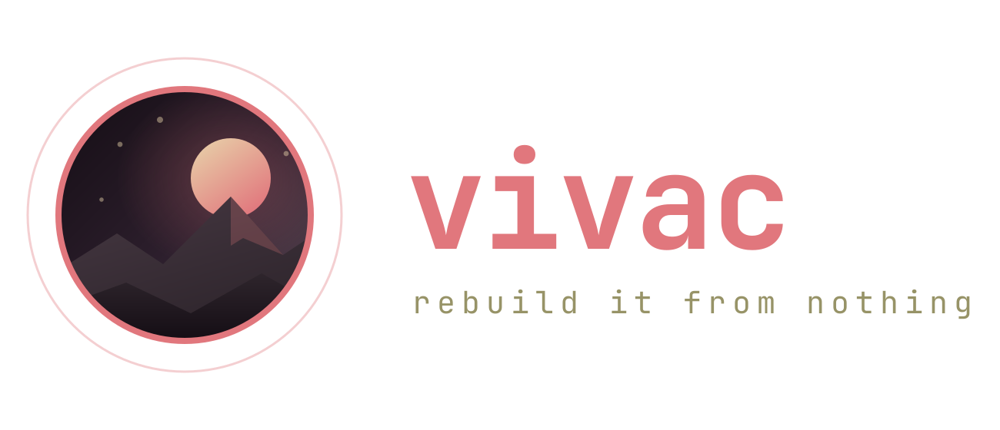
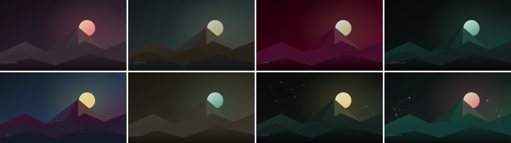

<div align="center">



<p>
<em>A <strong>vivac</strong> is the camp you pitch from what you carry and strike at dawn.<br>
This is one workstation, pitched on two floors: Arch Linux and Windows 11.</em><br>
<strong>What you carry is the same one file — twenty-odd lines of colour. Both systems render everything they show from it. Have both, and they also share what you choose, restart into each other, hand things across the dual boot and talk over the network.</strong>
</p>

<p>
  
  
  
  
  
</p>

<a href="#-the-two-halves"><strong>The two halves</strong></a> ·
<a href="#-together"><strong>Together</strong></a> ·
<a href="#-get-it"><strong>Get it</strong></a> ·
<a href="#-one-palette"><strong>One palette</strong></a> ·
<a href="#-versions"><strong>Versions</strong></a> ·
<a href="#-verification"><strong>Verification</strong></a>

</div>

---

<a href="#-one-palette"></a>

---

## 🏕️ The two halves

Each half stands on its own: clone the repository and use only the one you run.

<table>
<tr>
<th width="50%"><a href="linux/README.md">🐧 linux/</a> · <sub>1.1.0</sub></th>
<th width="50%"><a href="windows/README.md">🪟 windows/</a> · <sub>1.0.0</sub></th>
</tr>
<tr>
<td valign="top">

An Arch Linux workstation you can rebuild from nothing: Hyprland, Waybar,
kitty, rofi, dunst, hyprlock, a ReGreet greeter, hardware-aware rendering,
a bootable image verified from its own serial console.

</td>
<td valign="top">

The same workstation on Windows 11: GlazeWM, a Zebar bar that never goes
blank, and every window vivac shows — menu, lock, notifications, sound,
Bluetooth, network, security, updates — drawn by vivac itself in WPF.

</td>
</tr>
</table>

[docs/mapping.md](windows/docs/mapping.md) is the table of what each piece of one half became in the other,
and of what does not carry over.

---

## 🔗 Together

What you get when you run both — on one machine with a dual boot, on two machines on one network, or
both. [docs/bridge.md](docs/bridge.md) is the contract both halves implement.

| | Dual boot | Two machines |
|---|:---:|:---:|
| **Shared choices** — the theme, the weather location and the language follow you to the other system, through a file on a disk both mount | ✅ | |
| **Restart into the other system** — one entry in each power menu; it sets the firmware's *BootNext* for one boot only, never the boot order or GRUB's default | ✅ | |
| **The drop tray** — leave files in a folder on one side; the other says, at sign-in, that they are waiting | ✅ | |
| **vivac link** — send the clipboard, a link, a file or a notification to the other machine; paired once with a code, every request signed | | ✅ |

**Safe by construction.** vivac link never runs what it receives, never opens a link without a click,
writes files only into `Downloads/vivac-link/` under a name stripped of any path, and refuses a request
whose signature, clock or nonce is wrong. Each system's firewall lets in the local subnet only, and only
once you ask (`apply-system.ps1 -Link` on Windows, `apply-system.sh --bridge` on Linux). The restart needs administrator
rights on both sides; each grants exactly that one command and nothing more.

```text
linux                                    windows
  power menu: Restart in Windows  ───►     boots once into Windows
  boots once into Linux           ◄───     power menu: Restart in Linux

  drop/to-windows/   ── shared disk ──►    "3 waiting from Linux"
  vivac link send-file  ── network ──►     Downloads\vivac-link\
```

---

## 📥 Get it

```bash
git clone https://github.com/gitsual/vivac.git
```

| On | Then |
|---|---|
| Arch Linux | `cd vivac/linux && ./scripts/bootstrap.sh --dry-run` — see [linux/README.md](linux/README.md) |
| Windows 11 | `cd vivac\windows; powershell -ExecutionPolicy Bypass -File scripts\bootstrap.ps1 -DryRun` — see [windows/README.md](windows/README.md) (clone to a path without spaces, such as `C:\vivac`) |

To join the two once both are installed:

1. **Shared choices and the drop tray** — point `shared_settings` at the same file on a disk both systems
   mount, on each side (`~/.config/vivac/settings` on Linux, `%APPDATA%\vivac\settings` on Windows).
2. **Restart into the other system** — Linux: `./scripts/apply-system.sh --bridge` installs the one sudo
   rule it needs (with the firewall rule and the link service). Windows: `bin\vivac-reboot-other.ps1
   -Register`, once, from an elevated PowerShell.
3. **vivac link** — `vivac-link pair` on one machine prints a code; `vivac-link pair CODE` on the other.
   On Windows the command is `bin\vivac-link.ps1`, then `-Register` to listen at sign-in and
   `apply-system.ps1 -Link` (elevated) to let the other machine in. `Super+Shift+B` on Linux and the
   menu on Windows hold the rest.

---

## 🎨 One palette

The eight palettes live once, in [shared/data/](shared/data/): `theme.conf`, `themes/*.conf`, the colour
corpus every colour must come from, the aesthetics and the root distances. Each half keeps a copy in its
own `data/` so it deploys on its own, and [shared/sync.sh](shared/sync.sh) (or `sync.ps1`) is the only
way those copies change — both halves' gates fail when a copy differs from the source.

```bash
$EDITOR shared/data/themes/carmen.conf
shared/sync.sh            # copy into linux/data and windows/data
shared/sync.sh --check    # what the gates run
```

---

## 🏷️ Versions

| | Version | Tag |
|---|---|---|
| The product | [`VERSION`](VERSION) · 2.0.0 | `vX.Y.Z` |
| The Linux half | [`linux/VERSION`](linux/VERSION) · 1.1.0 | `linux-vX.Y.Z` |
| The Windows half | [`windows/VERSION`](windows/VERSION) · 1.0.0 | `windows-vX.Y.Z` |
| The bridge protocol | `v1`, in every request path and beacon | — |

The product's 2.0.0 is the layout: until 1.0.0 this repository was the Linux half alone, at its root. The
Windows half came from [gitsual/vivac-windows](https://github.com/gitsual/vivac-windows), merged with its
history.

---

## ✅ Verification

```bash
cd linux && ./scripts/check.sh                                  # Arch: every Linux gate
cd windows; powershell -File scripts\check.ps1                  # Windows: every Windows gate
shared/sync.sh --check                                          # the palettes agree
```

> **Author-run, not CI.** Like each half, every claim here rests on checks run by hand before
> publication. There is no hosted pipeline re-running them on each commit.

---

## 🗂️ Repository map

```text
linux/       The Arch Linux half (its own README, scripts, gates)
windows/     The Windows 11 half (its own README, scripts, gates)
shared/      What both render from: the palettes, the corpus; sync.sh / sync.ps1
docs/        bridge.md, the contract between the halves
VERSION      The product's version; each half has its own
```

## 📄 License

[MIT](LICENSE) — except `windows/static/zebar/vivac/zebar-client.js`, the vendored
[Zebar](https://github.com/glzr-io/zebar) client, which keeps its own licence (GPL-3.0-only).

---

<div align="center">


<sub>Built because a colour scheme you cannot rebuild is a mood, not a configuration — on any floor.</sub>

</div>
